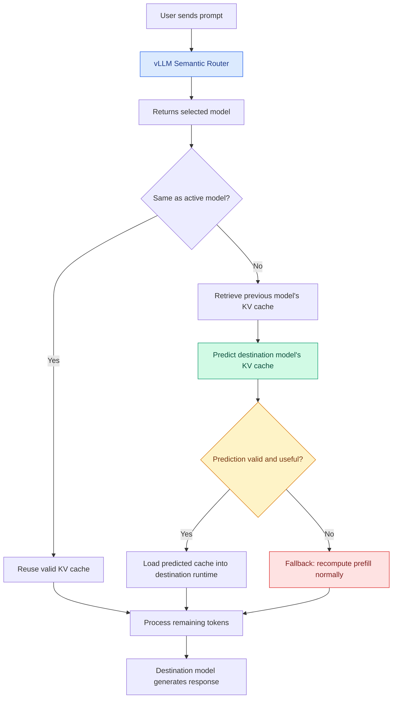

# Tandem

Developer Names:
Justin Kwinecki,
Zayed Umer,
William Pol,
Manav Patel and
Musab Mondal

Date of project start:
September 21, 2026

This project is ...

The folders and files for this project are as follows:

docs - Documentation for the project
refs - Reference material used for the project, including papers
src - Source code
test - Test cases
etc.

The documentation for this project is updated on the project's [GitHub page](https://smiths.github.io/capTemplate/). <!-- update for your project!  -->
## Architecture

The system integrates semantic routing with a KV-cache prediction
layer to investigate reducing redundant prefill computation when
switching between language models.

> **Status:** Cross-model KV-cache prediction and reuse are proposed
> functionality and remain under investigation.